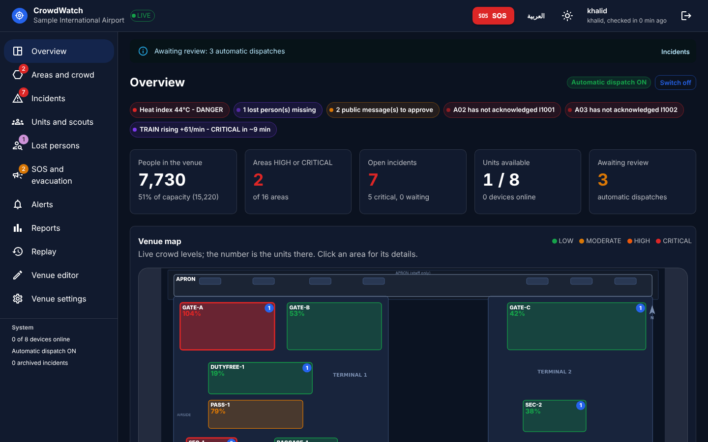

# CrowdWatch

[](https://github.com/Firas221/crowdwatch/actions/workflows/ci.yml)

Crowd monitoring and response for any venue: an airport, a stadium, the Holy Mosques or a mall, each described in a plain-text venue file.

CrowdWatch keeps live people counts for every area, works out how crowded each area is, and sends the nearest suitable unit to incidents. It supports the control room with automation, an SOS and evacuation plan, lost-person handling and a live venue map. It is a general version of the Umra Tech crowd-management project.



## Quick start

You need **Java 17 or newer** to run CrowdWatch. To build it from source you also need **Git** and **Node.js 20 or newer**. Maven is fetched by the project itself.

```bash
./download-dependencies.sh   # once: Maven, the Java and web libraries
./build.sh                   # the core: program/CrowdWatch.jar and 142 tests
./build-spring.sh            # the server and console: program/CrowdWatch-server.jar
program/run-server.sh airport 8080 MyControlKey
```

Then open `http://<this-computer>:8080/` in any browser. On Windows, use the `.bat` files instead. Each release on GitHub has a ready-to-run zip with both jars, so a venue that uses a release needs only Java.

| What | How |
|---|---|
| Control-room server | `program/run-server [venue] [port] [control-key] [scout-key]`. The venue is airport, stadium, umrah or a `.venue` file. |
| Users | `program/add-user <name> <OPERATOR\|OFFICER\|ADMIN>`. The first user should be an ADMIN. |
| HTTPS | Set `CROWDWATCH_HTTPS=1` before `run-server`. |
| Scout phones | `http://<server>:8080/scout`, with the unit's device code |
| Desktop console | `program/run` (JavaFX is included for Windows, Linux x64 and macOS) |
| Training drill | `program/run-drill airport 8081 ../examples/airport-fire.drill` |
| Run as a service | Fill in `program/service.conf`, then run `install-service-windows.bat` as administrator, or `sudo ./install-service-linux.sh` / `sudo ./install-service-mac.sh` |
| Tests | `program/run-tests` for the 142 core tests; `build-spring` also runs the server and console tests |

## What it does

- **Live crowd picture**: counts per area from sensors, staff or other systems; crowd levels from capacity and from people per m²; a trend warning up to 10 minutes before an area becomes critical; a live venue map.
- **Dispatch**: the nearest unit with the right skill and language, by real walking time. Incidents that wait sit in priority queues. Units get their tasks on their phones and radios, and must acknowledge them.
- **Automation**: automatic dispatch to crowded areas (reviewed by an officer) and reinforcement. It also checks sensors, chases units that haven't arrived, holds the flow into busy areas, prepares for scheduled peaks, drafts public messages (an officer approves them) and handles shift handovers.
- **Emergencies**: SOS with backup, and evacuation plans that spread people over the exits with an estimated time to clear. A system can propose an evacuation, but only an officer starts one. Lost persons get a lookout to every unit and a widening search area.
- **Control-room console** in any browser: every view, with changes pushed the moment they happen. It also has reports, replay, a venue editor, a head-office view, and English and Arabic.
- **Security**: personal logins with three roles, optional two-step sign-in, and scout-phone codes that only work for their own unit. Every change goes into an audit log. HTTPS is built in, and personal data is encrypted.
- **Data**: an Apache Derby database inside the program. Changes are saved within about 10 seconds, with daily backups.
- **Integration**: sensor feeds by folder, web address or socket; a JSON API; gateways for radio, SMS and urgent alerts; health checks and Prometheus metrics.

## How it is built

| Part | Folder | Technology |
|---|---|---|
| Core: monitor, rules, hand-written data structures | `source/src/crowdwatch` | Java 17 |
| Server | `server/` | Spring Boot, Spring Security, WebSocket |
| Control-room console | `web/` | React, TypeScript, Vite, MUI, Apache ECharts, TanStack Query, react-i18next |
| Desktop console | `source/src/crowdwatch/fx` | JavaFX |
| Database | `source/src/crowdwatch/db` | Apache Derby |

Spring Security checks who is calling and their role before any CrowdWatch code runs. Spring controllers then serve the console's reads and the control-room changes, using the same rules, audit log and data code as the core. See the C4 diagrams: [landscape (level 0)](docs/diagrams/c4-level0-landscape.png), [context (level 1)](docs/diagrams/c4-level1-context.png), [containers (level 2)](docs/diagrams/c4-level2-containers.png), [server components (level 3)](docs/CrowdWatch_Web-Layer.png); and the use cases per venue in chapter 5 of the guide.

## Folders

| Folder | Contents |
|---|---|
| `program/` | Ready-to-run jars, run scripts, service installers, JavaFX |
| `source/` | The core's Java source and the Derby libraries |
| `server/`, `web/` | The Spring Boot server and the React console |
| `docs/` | Design and Integration Guide (PDF and Word); C4 diagrams (levels 0 to 2), use-case diagrams per venue and the web-layer and class diagrams in `docs/diagrams` and `docs/`; the generators in `docs/source` |
| `examples/` | Template venue file explaining every line, its drawing, sample counts, a drill script |
| `test-evidence/` | Test output and the load tests |
| `screenshots/` | The consoles, the scout phone and the help page |

The full documentation is [the Design and Integration Guide](docs/CrowdWatch_Design-and-Integration-Guide.pdf). It covers set-up, the architecture (C4 levels 0 to 4), use cases for each venue, venue files, the consoles, automation, security, data and backups, the API, running a venue, the tests, and the known limitations. `README.txt` is a short plain-text version of this page for the release zip.

## Licence

MIT (see `LICENSE`). Apache Derby (Apache License 2.0), OpenJFX (GPL v2 with the Classpath Exception), Spring Boot (Apache License 2.0), React (MIT) and the other libraries keep their own licences.
